# Singletonopoly

This is a game with a command line interface made using Kotlin. All of the Kotlin files in this repo are copies of the files in an IntelliJ IDEA project of mine. The Game.kt file has the `main` function and the `Game` class, which has most of the code for playing a game. The other Kotlin files have classes, [object declarations (singletons)](https://kotlinlang.org/docs/object-declarations.html#object-declarations-overview), and Misc.kt has functions. Some files have documentation. Some, such as the `PlayerManager` class, seem simple enough that they don't need documentation. Some, such as the `ActionDeck` class, have some code that's explained by some info in the manual.


## Game Objective

Roll some dice, move around a board, and buy some properties. Get money from other players when they land on your properties. :heavy_dollar_sign: :moneybag: :money_with_wings: :money_mouth_face: Remove other players from the game by making them lose all their money and properties. Be the last person remaining in the game. In other words, make the set of players in the game a singleton set that consists of only you.


## Language Used

I did this project with my now-favorite language Kotlin. At the time I started this project, I think my favorite language was Java :coffee:. I decided to use Kotlin because I had a little experience from using it for an Android development course in college. I'm glad I learned it and decided to use it.

Kotlin is statically typed and similar to C# and Java in terms of features, though much of the syntax is different. I think Kotlin is more similar to C#; however, a notable similarity Kotlin has with Java is that Kotlin code can be compiled to Java bytecode! Kotlin code can also be compiled to native binaries or transpiled to front-end JavaScript.

Here's a [Kotlin Docs article that gives a brief overview of syntax and some features of the language and has links to more detailed documentation articles](https://kotlinlang.org/docs/basic-syntax.html). You can also use the menu on the left edge of that page to access other articles. Here's the [Kotlin Standard Library documentation](https://kotlinlang.org/api/latest/jvm/stdlib/). If you go to the page for a class or function in the Standard Library, not only does that page describe the class or function but it also provides a link to the source code. Throughout the rest of the "Language Used" section, including the collapsible section below, I'll give some links to pages in the Kotlin Docs and Standard Library documentation.

I like the features of Kotlin. Some of my favorite ones include [null safety](https://kotlinlang.org/docs/null-safety.html), [lambda features](https://kotlinlang.org/docs/lambdas.html#lambda-expressions-and-anonymous-functions) such as how `it` is the implicit param and the last expression is the return value, [extension functions](https://kotlinlang.org/docs/extensions.html), [destructuring](https://kotlinlang.org/docs/destructuring-declarations.html), and the ability to [name args when calling functions](https://kotlinlang.org/docs/functions.html#named-arguments). I also like the abundance of functions that the Standard Library provides.

More info about Kotlin features used in this project is in the collapsible section below.

<details>
<summary>More Info</summary>

#### Destructuring

This is done several times in this project. Any object can be configured to be able to be destructured and several built-in objects are configured this way. The objects that are destructured in this project are [`Map.Entry`](https://kotlinlang.org/api/latest/jvm/stdlib/kotlin.collections/-map/-entry/)s and [`IndexedValue`](https://kotlinlang.org/api/latest/jvm/stdlib/kotlin.collections/-indexed-value/)s. More info about destructuring can be found [here](https://kotlinlang.org/docs/destructuring-declarations.html).

#### Object Declarations (Singletons)

There are several object declarations used, including some companion objects. More info about these can be found [here](https://kotlinlang.org/docs/object-declarations.html#object-declarations-overview).

#### Sealed Classes

The `Property` class is sealed :zipper_mouth_face:. More info about sealed classes can be found [here](https://kotlinlang.org/docs/sealed-classes.html). The 3 subclasses of `Property` are `Street`, `GolfClub`, and `SuperStore`. The benefit to using a sealed class is in the [`handleLandingOnOwnedProp` function in the `Game` class](https://github.com/ncschroeder/Singletonopoly/blob/13077747ecc30be97e008dd03af5b4461074ce5e/src/main/Game.kt#L518-L593).

<details>
<summary>Part of handleLandingOnOwnedProp</summary>
<br/>

```kotlin
fun handleLandingOnOwnedProp(prop: Property, owner: Player) {
    ...
    val fee: Int
    
    when (prop) {
        is Street -> {
            fee = ...
            ...
        }
        
        is GolfClub -> prop.FeeData().let {
            ...
            fee = ...
            ...
        }
        
        is SuperStore -> {
            ...
            fee = ...
            ...
        }
    }
    
    // Do some stuff with fee.
}
```

Using a sealed class allows us to guarantee the compiler that `fee` will be set. If we didn't use a sealed class, we would have to do something such as initialize `fee` with `var fee = 0` instead of `val fee: Int` or have an `else` branch in the `when` statement and throw an exception or set `fee` to something in there.

</details>

#### Extension Functions

The [`PropertyManager` object](https://github.com/ncschroeder/Singletonopoly/blob/master/src/main/board/properties/PropertyManager.kt) has an extension function for `List<Property>`, `getInfo`. The [`Misc` object](https://github.com/ncschroeder/Singletonopoly/blob/master/src/main/Misc.kt) has an extension function for `Iterable`, `joinToStringBuilder`. More info about extension functions can be found [here](https://kotlinlang.org/docs/extensions.html).

#### Lambdas

These are often used in this project. Info about lambda syntax and features can be found [here](https://kotlinlang.org/docs/lambdas.html#lambda-expressions-and-anonymous-functions).

#### Scope Functions

The functions [`let`](https://kotlinlang.org/api/latest/jvm/stdlib/kotlin/let.html), [`run`](https://kotlinlang.org/api/latest/jvm/stdlib/kotlin/run.html), [`with`](https://kotlinlang.org/api/latest/jvm/stdlib/kotlin/with.html), [`also`](https://kotlinlang.org/api/latest/jvm/stdlib/kotlin/also.html), and [`apply`](https://kotlinlang.org/api/latest/jvm/stdlib/kotlin/apply.html) are known as *scope functions* and these are a special type of higher-order function. `let`, `run`, `with`, and `apply` are occasionally used in this project, with `let` being the most frequently used. I used `let` to reduce variable usage and conditionally run some code if a value isn't null; `run` and `with` to reduce variable usage and easily access multiple properties of an object; and `apply` to easily create an object, immediately modify it, and store it to a variable or return it from a function. More info about scope functions can be found [here](https://kotlinlang.org/docs/scope-functions.html).

<details>
<summary>Examples</summary>

##### `let`

First, **let**'s focus on `let`. The code below is in the [`handleLandingOnOwnedProp` function in the `Game` class](https://github.com/ncschroeder/Singletonopoly/blob/13077747ecc30be97e008dd03af5b4461074ce5e/src/main/Game.kt#L518-L593). It's a little bit of the code used for handling when a player lands on an owned street.

```kotlin
fun handleLandingOnOwnedProp(prop: Property, owner: Player) {
    ...
    when (prop) {
        is Street -> {
            fee = prop.curFee
            println(
                prop.numRestaurants.let {
                    "There${if (it == 1) "'s 1 restaurant" else " are ${if (it == 0) "no" else it} restaurants"} " +
                    "on this street and the fee is $${fee.toStringWithCommas()}."
                }
            )
        }
        ...
    }
    ...
}
```

This is an alternative to:

```kotlin
println(
    "There ${if (prop.numRestaurants == 1) "is 1 restaurant" else "are ${if (prop.numRestaurants == 0) "no" else prop.numRestaurants} restaurants"} " +
    "on this street and the fee is $${fee.toStringWithCommas()}."
)
```

Another use of `let` is to run some code if a nullable value isn't null after using the [safe call operator (`?.`)](https://kotlinlang.org/docs/null-safety.html#safe-call-operator). The [`PlayerManager` class](https://github.com/ncschroeder/Singletonopoly/blob/master/src/main/players/PlayerManager.kt) has a `winnerName` `String?` (nullable string) property that's used in the [`init` block in the `Game` class](https://github.com/ncschroeder/Singletonopoly/blob/13077747ecc30be97e008dd03af5b4461074ce5e/src/main/Game.kt#L100-L140):

```kotlin
playerManager.winnerName?.let { println("\nThe winner is $it!\n") }
```

This is an alternative to:

```kotlin
val winnerName: String? = playerManager.winnerName
if (winnerName != null) {
    println("\nThe winner is $winnerName!\n")
}
```

##### `run`

The beginning of the [`PropertyManager` object](https://github.com/ncschroeder/Singletonopoly/blob/master/src/main/board/properties/PropertyManager.kt) is:

```kotlin
val SUPER_STORES_AND_GOLF_CLUBS_COMMON_INFO: String =
    SuperStore.newtonStore.run {
        "For Super Stores and Golf Clubs: Purchase Price: $$purchasePrice, " +
        "Pawn Gain: $$pawnGain, Unpawn Price: $$unpawnPrice"
    }
```

This is an alternative to:

```kotlin
"For Super Stores and Golf Clubs: Purchase Price: $${SuperStore.newtonStore.purchasePrice}, " +
"Pawn Gain: $${SuperStore.newtonStore.pawnGain}, Unpawn Price: $${SuperStore.newtonStore.unpawnPrice}"
```

##### `with`

The beginning of the [`rollDiceAndMove` function in the `Game` class](https://github.com/ncschroeder/Singletonopoly/blob/13077747ecc30be97e008dd03af5b4461074ce5e/src/main/Game.kt#L408-L426) is:

```kotlin
val diceRoll = DiceRoll()
with(diceRoll) {
    printBlankLnAnd("${curPlayer.name} rolled a $die1Val and a $die2Val for a total of $total.")
}
```

This is an alternative to:

```kotlin
val diceRoll = DiceRoll()
printBlankLnAnd("${curPlayer.name} rolled a ${diceRoll.die1Val} and a ${diceRoll.die2Val} for a total of ${diceRoll.total}.")
```

##### `apply`

The beginning of the [`ActionDeck` class](https://github.com/ncschroeder/Singletonopoly/blob/master/src/main/actiondeck/ActionDeck.kt) is:

```kotlin
private val cardsQueue: Queue<ActionCard>

init {
    /*
    Use an array list to shuffle the cards since the Fisher-Yates shuffle, the shuffling algorithm
    used by Kotlin, accesses elements by index.
     */
    val shuffledCards: List<ActionCard> =
        arrayListOf(
            MoneyGainCard(gainAmount = 128),
            MoneyGainCard(gainAmount = 256),
            MoneyLossCard(lossAmount = 128),
            MoneyLossCard(lossAmount = 256),
            // 17 more ActionCards
        )
        .apply { shuffle() }
    
    cardsQueue = ArrayDeque(shuffledCards)
}
```

This is an alternative to:

```kotlin
val cards: ArrayList<ActionCard> =
    arrayListOf(
        // 21 ActionCards
    )

cards.shuffle()
cardsQueue = ArrayDeque(cards)
```

</details>

#### Functions with Receivers

The `run`, `with`, and `apply` scope functions have a param named `block` and the type of it is `T.() -> Unit`, where `T` is a type param. The [`buildList`](https://kotlinlang.org/api/latest/jvm/stdlib/kotlin.collections/build-list.html) function has a param named `builderAction` and the type of it is `MutableList<E>.() -> Unit`, where `E` is a type param. These types are functions with a receiver and the receiver type is the type before the `.()`. This type of function can be created with a lambda and inside that lambda, you can access members of the receiver type without needing an instance of that type.

<details>
<summary>buildList Usage</summary>

This is in the [`PropertyManager` object](https://github.com/ncschroeder/Singletonopoly/blob/master/src/main/board/properties/PropertyManager.kt):

```kotlin
fun List<Property>.getInfo(heading: String, commonInfo: String): CharSequence =
    buildList(capacity = size + 2) {
        add(heading)
        add(commonInfo)
        for (prop in this@getInfo) {
            add(prop.getInfo())
        }
    }
    .joinToStringBuilder(separator = "\n")
```

`add` is a [`MutableList`](https://kotlinlang.org/api/latest/jvm/stdlib/kotlin.collections/-mutable-list/) function that would otherwise be called like `someMutableList.add(...)`.

</details>

More info about functions with receivers can be found [here](https://kotlinlang.org/docs/lambdas.html#function-types) and [here](https://kotlinlang.org/docs/lambdas.html#function-literals-with-receiver).

#### Eager and Lazy Collection Operations

Some collection operations, such as mapping and filtering, can be either eagerly or lazily evaluated. If one of those operations is performed on an [`Iterable`](https://kotlinlang.org/api/latest/jvm/stdlib/kotlin.collections/-iterable/), [`Array`](https://kotlinlang.org/api/latest/jvm/stdlib/kotlin/-array/), [`String`](https://kotlinlang.org/api/latest/jvm/stdlib/kotlin/-string/), [`CharSequence`](https://kotlinlang.org/api/latest/jvm/stdlib/kotlin/-char-sequence/), or [`Map`](https://kotlinlang.org/api/latest/jvm/stdlib/kotlin.collections/-map/); then it'll be eagerly evaluated and if performed on a [`Sequence`](https://kotlinlang.org/api/latest/jvm/stdlib/kotlin.sequences/-sequence/), then it'll be lazily evaluated. `Iterable` and `Sequence` are interfaces that have a type param `T` and require an implementation of `operator fun iterator(): Iterator<T>`. The same operations can be performed on iterables and sequences and many of those operations can also be performed on arrays, strings, char sequences, and maps. `Iterable` is the interface that types such as [`List`](https://kotlinlang.org/api/latest/jvm/stdlib/kotlin.collections/-list/), [`Set`](https://kotlinlang.org/api/latest/jvm/stdlib/kotlin.collections/-set/), and [`IntRange`](https://kotlinlang.org/api/latest/jvm/stdlib/kotlin.ranges/-int-range/) implement. As implied a few sentences ago; arrays, strings, char sequences, and maps aren't iterables. An iterable, array, string, char sequence, or map can be converted to a sequence by using the [`asSequence`](https://kotlinlang.org/api/latest/jvm/stdlib/kotlin.collections/as-sequence.html) function, though there are a few other ways to create a sequence.

Here's [an article that mostly goes over sequences and lazy evaluation but also goes over iterables and eager evaluation](https://kotlinlang.org/docs/sequences.html).

A good question is: when should eager evaluation be used and when should lazy evaluation be used? There's not a clear answer to that. The 4<sup>th</sup> paragraph of the article linked above gives some info about that. Here's that paragraph:

> So, the sequences let you avoid building results of intermediate steps, therefore improving the performance of the whole collection processing chain. However, the lazy nature of sequences adds some overhead which may be significant when processing smaller collections or doing simpler computations. Hence, you should consider both `Sequence` and `Iterable` and decide which one is better for your case.

In this project, there are several times when collection multi-step processing is done but the amount of elements involved in the intermediate steps is small. For this reason, I decided to do that processing with iterables, arrays, strings, and maps; which results in eager evaluation and intermediate collections.

<details>
<summary>Intermediate Collection Example</summary>

This is in the [`PropertyManager` object](https://github.com/ncschroeder/Singletonopoly/blob/master/src/main/board/properties/PropertyManager.kt) and was mentioned in the previous section, "Functions with Receivers":

```kotlin
fun List<Property>.getInfo(heading: String, commonInfo: String): CharSequence =
    buildList(capacity = size + 2) {
        add(heading)
        add(commonInfo)
        for (prop in this@getInfo) {
            add(prop.getInfo())
        }
    }
    .joinToStringBuilder(separator = "\n")
```
    
The built list will have at most 6 elements. An alternative to using `buildList` is using the [`sequence` function](https://kotlinlang.org/api/core/kotlin-stdlib/kotlin.sequences/sequence.html):

```kotlin
fun List<Property>.getInfo(heading: String, commonInfo: String): CharSequence =
    sequence {
        yield(heading)
        yield(commonInfo)
        for (prop in this@getInfo) {
            yield(prop.getInfo())
        }
    }
    .joinToStringBuilder(separator = "\n")
```
    
Though, I'd have to add a `joinToStringBuilder` extension function to `Sequence<T>`.

</details>

</details>


## Project History

<details>

During the spring of 2020, I thought it would be interesting to make computerized versions of some board games. I was also planning on doing an independent study course over the summer. I came up with the idea of making computerized versions of some board games for the independent study course. I proposed my idea to one of my professors who would be a sponsor for the course and they accepted. I decided that Monopoly would be one of the games I would implement. I decided to make a parody, which in time would be called Singletonopoly. I thought this game would be challenging but not overwhelming to implement. I decided to use Kotlin because I had a little experience by using it for an Android development course, the professor of which was the professor I proposed my idea to.

I started the work in June 2020. The independent study course came to an end at the end of July. By that time, I wasn't done but submitted my work to the professor and then got an A for the course and got my Bachelor's degree in Computer Science. :man_student: I spent more time to finish the project and got a finished version uploaded to GitHub in October. Refactoring was done and other changes were made throughout 2021, 2022, and 2023.

One part of the project that got changed significantly was the manual. This started off having 10 sections, ~1,200 words, and no lists, tables, flowcharts, pie charts :pie: :chart_with_upwards_trend:, nor emojis. :slightly_smiling_face: I was able to come up with a lot more stuff that could be added to the manual and now, as mentioned in the "Manual" section, it has 15 sections, ~4,500 words, 7 lists, 5 tables, 3 flowcharts, 1 pie chart, and ~40 emojis.

### Refactoring Examples

#### Higher-Order Functions

In early versions of this project, something that I didn't use very much are higher-order functions. Some examples are in the `PlayerManager` class. Here's some old code for finding the count of players that are in the game:

https://github.com/ncschroeder/Singletonopoly/blob/19bbbdd34e26252db5399f8cca1456611c915755/PlayerManager.kt#L138-L147

In the current version, that count is found using `players.count { it.isInGame }`.

Here's some old code for building a string that contains info about players:

https://github.com/ncschroeder/Singletonopoly/blob/e5c09b1f3ce4883acd655f0636b6247a3b49c253/PlayerManager.kt#L142-L148

Here's the current implementation:

https://github.com/ncschroeder/Singletonopoly/blob/5698b1b60623068af849a7a02126efa571dba267/PlayerManager.kt#L22-L23

#### Enums

Another problem with early versions of this project was an inappropriate use of string literals. Namely, the non-property spaces that are now implemented as the `NonPropertySpace` enum used to be implemented with string literals. String literals were used by the `boardSpaces` array in the `Board` class like this: 

```kotlin
private val boardSpaces = arrayOf(
    "Start",
    ...
    "Draw Action Card",
    ...
    "Break Time",
    ...
)
```

As a result of that, the `getBoardSpace` function would possibly return those strings and then the `evaluatePosition` function in the `Game` class would have to use string literals to check a result, as seen in this code snippet:

https://github.com/ncschroeder/Singletonopoly/blob/19bbbdd34e26252db5399f8cca1456611c915755/Game.kt#L370-L385

This is bad because of the possibility of typos. Since an enum is used now, typos aren't a problem since there'll be a compilation error if you misspell the name of an enum or one of its constants. Though, you don't even have to type out the enum or constant name. You can just start typing the enum name and then your IDE should display an autocomplete option with that name. You can select this and type a `.` and then your IDE should display autocomplete options with the enum constant names and you can select one.

The `Board` object now has a `spacesMap` and the values of that map come from the elements of an array and some of these elements are instances of the `NonPropertySpace` enum like this:

```kotlin
private val spacesMap: Map<Int, Any> =
    arrayOf(
        NonPropertySpace.START,
        ...
        NonPropertySpace.DRAW_ACTION_CARD,
        ...
        NonPropertySpace.BREAK_TIME,
        ...
    )
    ...
```

As a result of this, the `getSpace` function will possibly return a `NonPropertySpace` and then the `evaluatePosition` function can easily check if an instance of that got returned and which instance got returned, as seen in this code snippet:

https://github.com/ncschroeder/Singletonopoly/blob/5698b1b60623068af849a7a02126efa571dba267/Game.kt#L372-L388

</details>


## Manual

This manual has a lot of info about the game but virtually no info about the implementation of it. There are 15 sections, ~4,500 words, 7 lists, 5 tables, 3 flowcharts, 1 pie chart :pie: :chart_with_upwards_trend:, and ~40 emojis. :slightly_smiling_face:

The flowcharts and pie chart are generated by the diagramming and charting tool Mermaid :mermaid: and were conveniently able to be added by adding some code to the Markdown. Here's a [*GitHub Docs* article on creating diagrams](https://docs.github.com/en/get-started/writing-on-github/working-with-advanced-formatting/creating-diagrams) and here's the [Mermaid website](https://mermaid.js.org/).

There are also some mathematical expressions in this manual that can be written with GitHub Markdown, such as $p + d \leq 40$. That expression was written using `$p + d \leq 40$`. Here's a [*GitHub Docs* article on writing mathematical expressions](https://docs.github.com/en/get-started/writing-on-github/working-with-advanced-formatting/writing-mathematical-expressions).

### Players: 2-8

### Beginning

The game will ask for the number of players and names of them. Leading and trailing whitespace will be ignored. The names must be 1-20 characters and unique, meaning that 2 names can’t contain the same characters in the same order. An uppercase letter and the corresponding lowercase letter are different characters. If a name is entered that's the same as a name that was entered for a previous player, then a message saying this will be shown and a new name will need to be entered. The names entered here will be shown throughout the game.


A roll of 2 dice will be generated for each player after their name is entered. :game_die: :game_die: Just like standard physical dice, each die rolled here and throughout the game has a minimum value of 1 and a maximum value of 6. The order of the players will be determined by these dice rolls in descending order, meaning that higher rolls go first. If there are ties, then the order of the players that tied will be randomized. For example; if 1 player gets a 12, 2 players get a 10, and 1 player gets a 7; then the player that got the 12 will be 1<sup>st</sup> and the player that got the 7 will be last and the order of the other 2 players will be randomized and one of them will be 2<sup>nd</sup> and the other will be 3<sup>rd</sup>.

After all names are entered, the order of the players is determined and shown and then the game starts and the 1<sup>st</sup> player takes their turn.

#### Screenshot

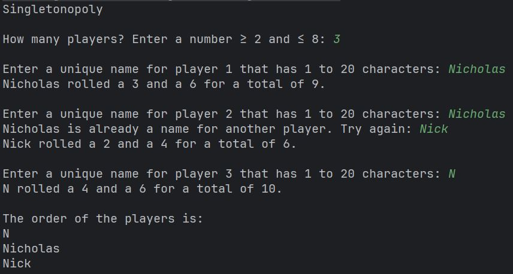


### Playing the Game

Money is used for buying properties, buying restaurants for streets, and paying fees. Players start with :heavy_dollar_sign:4,096 (2<sup>12</sup>). Along with this, there are other references to powers of 2 throughout the game.

#### Screenshot

Invalid input

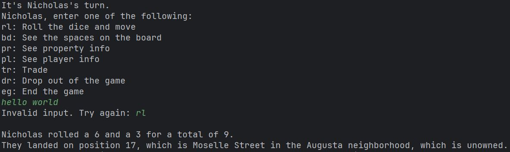

At the beginning of a player's turn, they have options to do things.

Things that can always be done:
- Roll the dice and move, unless the player is on vacation. In that case, they'll have the option to do a vacation action.
- See board spaces
- See property info
- See player info
- Make a trade
- Drop out
- End the game

Things that can conditionally be done if the player has at least 1 property where that action can be done:
- Pawn properties
- Unpawn properties
- Buy restaurants for streets
- Sell restaurants on streets

When a player decides to roll the dice and move, 2 dice will be rolled for them. :game_die: :game_die: I'm going to use the variables $p$ to represent the player's current position and $d$ to represent the sum of the values of the dice. There are 40 board spaces. If $p + d \leq 40$, the player's new position is $(p + d)$. If $p + d > 40$, the player made a revolution around the board and their new position is the difference between $(p + d)$ and $40$. For example, if $p + d = 42$, the new position is 2. After a revolution, a player gains :heavy_dollar_sign:512. The player's new position will be evaluated and appropriate action will be taken. If the values of both dice are the same, also called *rolling doubles*, that player gets to go again. If a player rolls doubles thrice, or 3 times, in a row, they'll be sent to [vacation](#vacation-desert_island-beach_umbrella).

<details>
<summary>Screenshots</summary>
<br/>

All options that can be done at the beginning of a turn

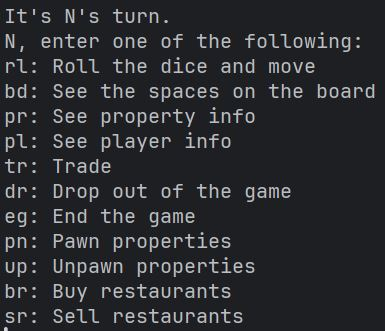

Rolling the dice and moving

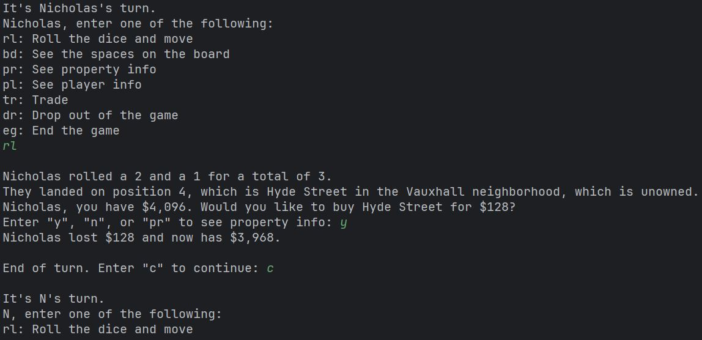

Making a revolution

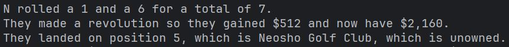

Rolling doubles

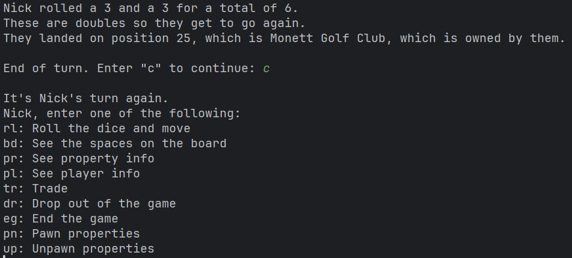

A player dropping out

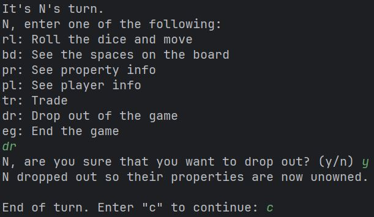

</details>

<details>
<summary>Screenshots</summary>
<br/>

Using the option

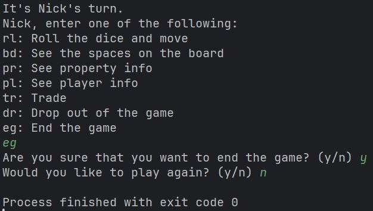

A player dropping out

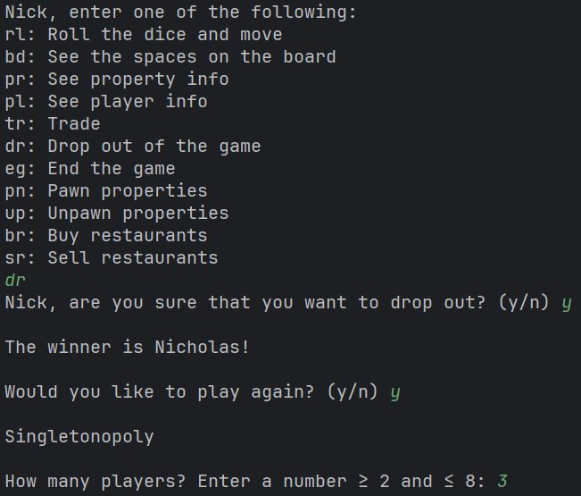

</details>


### The Board

As mentioned in the previous section, there are 40 spaces:
- 30 Properties
    - 24 Streets
    - 4 Golf Clubs
    - 2 Super Stores
- 5 Draw Action Card
- 2 Break Time
- Start
- Go on Vacation
- Vacation

Here's a pie chart that displays the percentages of each type of space:

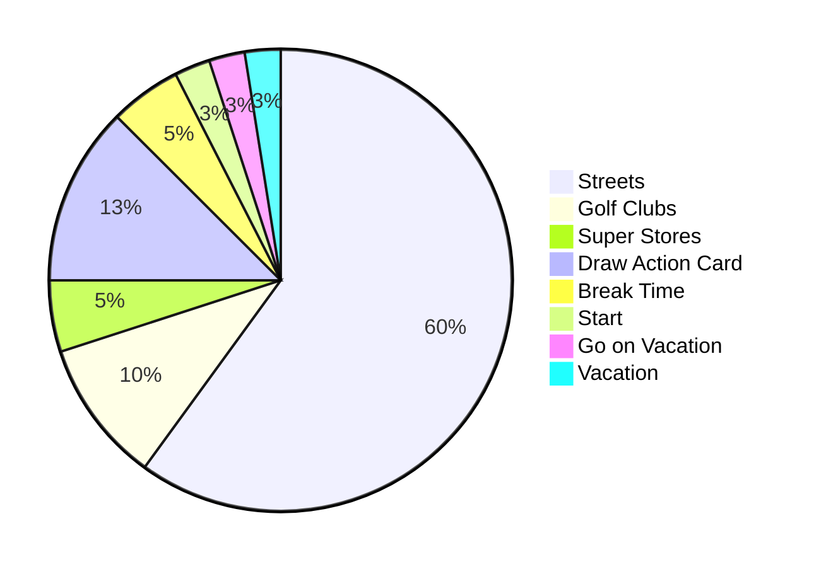

The "Start," "Break Time," and "Vacation" spaces have no effect when landing on them. The effects of the other spaces are described in their section in this manual.

Here are all the spaces on the board. The spaces with streets have the street name shown followed by their neighborhood.

| Position | Space                        |
| :------: | ---------------------------- |
|    1     | Start                        |
|    2     | Newburn Street, Vauxhall     |
|    3     | Thames Avenue, Vauxhall      |
|    4     | Hyde Street, Vauxhall        |
|    5     | Neosho Golf Club             |
|    6     | Draw Action Card             |
|    7     | Luanda Lane, Monrovia        |
|    8     | Newton Super Store           |
|    9     | Kinshasa Street, Monrovia    |
|    10    | Lagos Avenue, Monrovia       |
|    11    | Camden Court, Ozark          |
|    12    | Break Time                   |
|    13    | Lake Shore Drive, Ozark      |
|    14    | Osage Beach Parkway, Ozark   |
|    15    | Labadie Avenue, Augusta      |
|    16    | Draw Action Card             |
|    17    | Moselle Street, Augusta      |
|    18    | Granby Golf Club             |
|    19    | Clover Bottom Road, Augusta  |
|    20    | Ezio Avenue, Little Italy    |
|    21    | Vacation                     |
|    22    | Firenze Way, Little Italy    |
|    23    | Venezia Street, Little Italy |
|    24    | Draw Action Card             |
|    25    | Monett Golf Club             |
|    26    | Go on Vacation               |
|    27    | Euler Street, Gauss          |
|    28    | Ramanujan Road, Gauss        |
|    29    | Euclid Avenue, Gauss         |
|    30    | Break Time                   |
|    31    | Dijkstra Drive, Turing       |
|    32    | Draw Action Card             |
|    33    | Knuth Street, Turing         |
|    34    | Leibniz Super Store          |
|    35    | Ritchie Road, Turing         |
|    37    | Chesapeake Avenue, Hampton   |
|    36    | Aurora Golf Club             |
|    38    | Draw Action Card             |
|    39    | Suffolk Street, Hampton      |
|    40    | Norfolk Avenue, Hampton      |

<details>
<summary>Screenshots</summary>
<br/>

Landing on "Break Time"

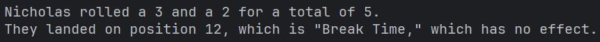

Seeing the spaces on the board

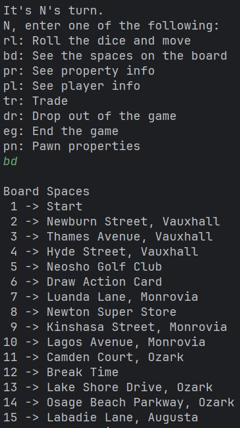

</details>


### Properties

The 3 types of properties are super stores, golf clubs, and streets. There are subsections below that give more info about these. Property names follow themes and these are revealed in the "Name Origins" collapsible sections in those subsections.

All properties are unowned at the beginning. If a player lands on an unowned property, they'll have the option to buy it. If they want to buy it but don't have enough money, they'll be sent to the [money getting section](#money-getting-section-heavy_dollar_sign) and if they get the money, the property will be given to them. If a player lands on a property that's owned by someone else and unpawned, they'll have to pay a fee to the owner. If they can't pay the fee, they'll be sent to the money getting section and if they decide to drop out, their money and properties will go to the owner of the property.

##### Screenshots

Buying a street

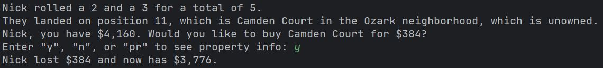

A player landing on a property owned by them

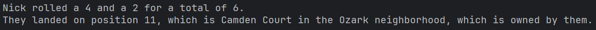

#### Super Stores &nbsp; :department_store:

There are 2 super stores: Newton Super Store and Leibniz Super Store. Each one has a purchase price of :heavy_dollar_sign:512 (2<sup>9</sup>), a pawn price of :heavy_dollar_sign:256 (2<sup>8</sup>), and an unpawn price of :heavy_dollar_sign:282. The fee for a super store is a dice roll multiplied by either 8 or 16, 16 for if the owner of that super store owns the other super store as well and 8 for if they don’t.

##### Screenshot

Landing on an owned super store

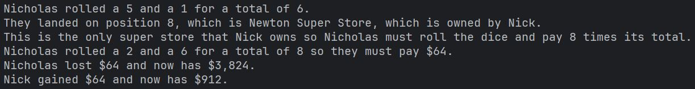

<details>
<summary>Name Origins</summary>

[Isaac Newton](https://en.wikipedia.org/wiki/Isaac_Newton) and [Gottfried Leibniz](https://en.wikipedia.org/wiki/Gottfried_Wilhelm_Leibniz) were mathematicians who invented and developed calculus.

</details>

#### Golf Clubs &nbsp; :golf: &nbsp; :golfing:

There are 4 golf clubs: Neosho Golf Club, Granby Golf Club, Monett Golf Club, and Aurora Golf Club. Each one has a purchase price of :heavy_dollar_sign:512 (2<sup>9</sup>), a pawn price of :heavy_dollar_sign:256 (2<sup>8</sup>), and an unpawn price of :heavy_dollar_sign:282. Golf clubs have a fee that depends on how many golf clubs the owner of that golf club owns. The formula is $\frac{512}{2^{4 - n}}$ or $2^{n + 5}$, where $n$ is the number of clubs owned. This gives us the following values:

| Number of Clubs Owned |  Fee  |
| :-------------------: | :---: |
|           1           |  $64  |
|           2           |  $128 |
|           3           |  $256 |
|           4           |  $512 |

##### Screenshot

Landing on an owned golf club

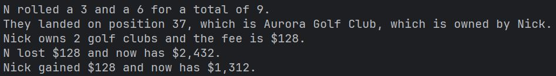

<details>
<summary>Name Origins</summary>

[Neosho](https://en.wikipedia.org/wiki/Neosho,_Missouri), [Granby](https://en.wikipedia.org/wiki/Granby,_Missouri), [Monett](https://en.wikipedia.org/wiki/Monett,_Missouri), and [Aurora](https://en.wikipedia.org/wiki/Aurora,_Missouri) are Missouri towns along [US Route 60](https://en.wikipedia.org/wiki/U.S._Route_60_in_Missouri) southwest of [Springfield](https://en.wikipedia.org/wiki/Springfield,_Missouri). That's a route I traveled on a few times during my time living in Springfield and attending Missouri State University.

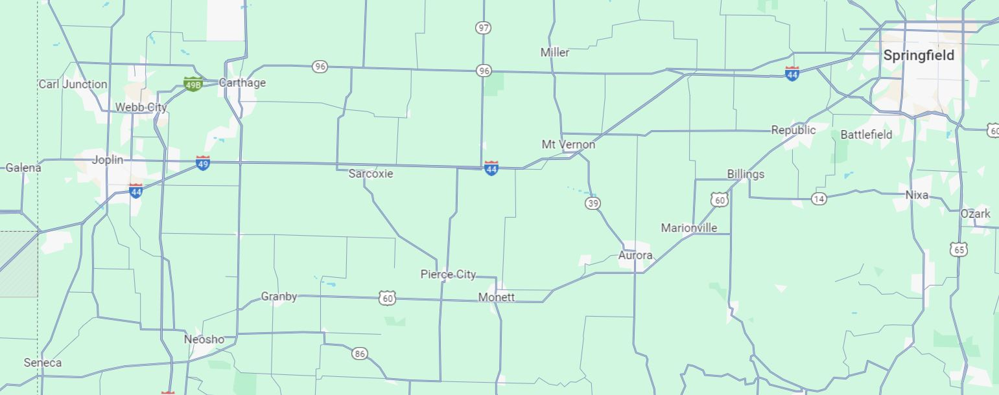

</details>

#### Neighborhoods and Streets :motorway:

There are 24 streets around the board that are grouped into 8 neighborhoods. If you ignore non-street spaces, the streets in a neighborhood are *contiguous*, or next to each other. Here are the streets in the same order that they appear on the board:

| Neighborhood | Street 1          | Street 2          | Street 3            |
| ------------ | ----------------- | ----------------- | ------------------- |
| Vauxhall     | Newburn Street    | Thames Avenue     | Hyde Street         |
| Monrovia     | Luanda Lane       | Kinshasa Street   | Lagos Avenue        |
| Ozark        | Camden Court      | Lake Shore Drive  | Osage Beach Parkway |
| Augusta      | Labadie Avenue    | Moselle Street    | Clover Bottom Road  |
| Little Italy | Ezio Avenue       | Firenze Way       | Venezia Street      |
| Gauss        | Euler Street      | Ramanujan Road    | Euclid Avenue       |
| Turing       | Dijkstra Drive    | Knuth Street      | Ritchie Road        |
| Hampton      | Chesapeake Avenue | Suffolk Street    | Norfolk Avenue      |

<details>
<summary>Name Origins</summary>

- The Vauxhall neighborhood is [London](https://en.wikipedia.org/wiki/London) themed. Vauxhall is a [area in London](https://en.wikipedia.org/wiki/Vauxhall) and an [English car company](https://en.wikipedia.org/wiki/Vauxhall_Motors). Newburn Street is a street in Vauxhall. The [River Thames](https://en.wikipedia.org/wiki/River_Thames) flows through London. [Hyde Park](https://en.wikipedia.org/wiki/Hyde_Park,_London) is a famous park in London.

    In the map below, the red dots form the outline of Vauxhall.


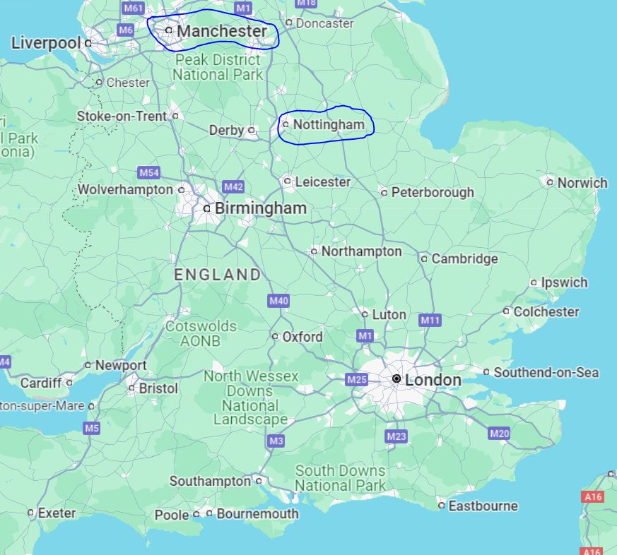
- [Monrovia, Liberia](https://en.wikipedia.org/wiki/Monrovia); [Luanda, Angola](https://en.wikipedia.org/wiki/Luanda); [Kinshasa, Democratic Republic of the Congo](https://en.wikipedia.org/wiki/Kinshasa); and [Lagos, Nigeria](https://en.wikipedia.org/wiki/Lagos) are cities in Africa. :earth_africa: Fun fact: Monrovia was named after 6<sup>th</sup> U.S. president James Monroe.


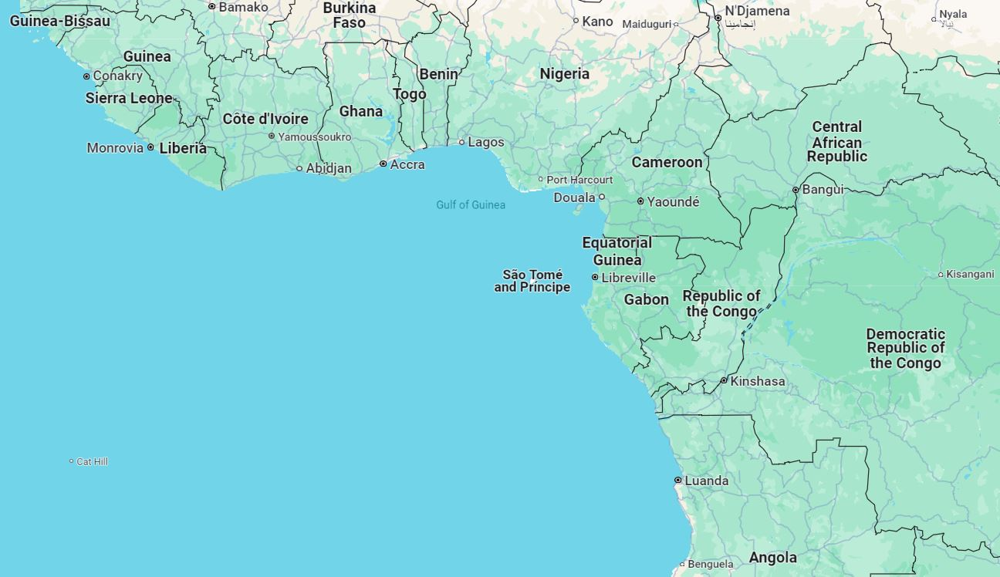

- The Ozark neighborhood is [Lake of the Ozarks](https://en.wikipedia.org/wiki/Lake_of_the_Ozarks) themed. :speedboat: :bikini: :sunrise: :swimming_man: [Camden County](https://en.wikipedia.org/wiki/Camden_County,_Missouri) is where most of the lake and surrounding area is. [Lake Shore Drive](https://en.wikipedia.org/wiki/Lake_Shore_Drive) is a road in Chicago but goes with the theme. [Osage Beach](https://en.wikipedia.org/wiki/Osage_Beach,_Missouri) is a city by the lake and there’s a road there called Osage Beach Parkway.

    In the map below, the red dots form the outline of Camden County.

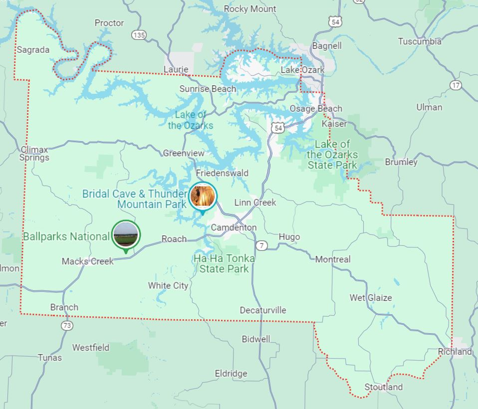
    

    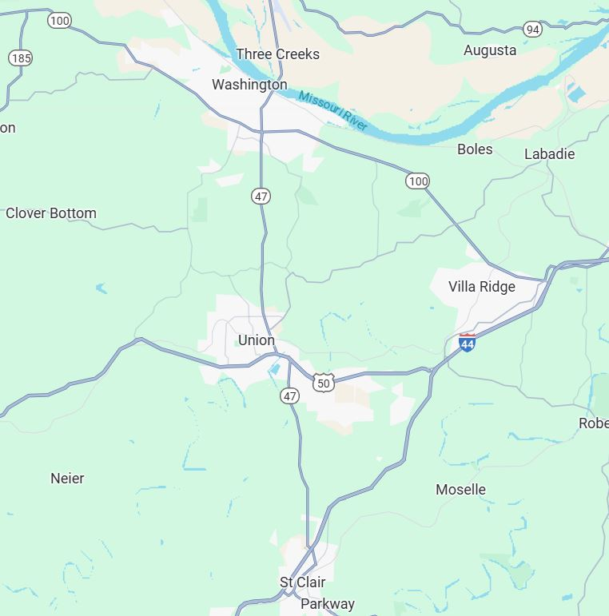

- [Augusta](https://en.wikipedia.org/wiki/Augusta,_Missouri), [Labadie](https://en.wikipedia.org/wiki/Labadie,_Missouri), [Moselle](https://en.wikipedia.org/wiki/Moselle,_Missouri), and [Clover Bottom](https://en.wikipedia.org/wiki/Clover_Bottom,_Missouri) are communities close to [Union, Missouri](https://en.wikipedia.org/wiki/Union,_Missouri), where I spent much of my life.

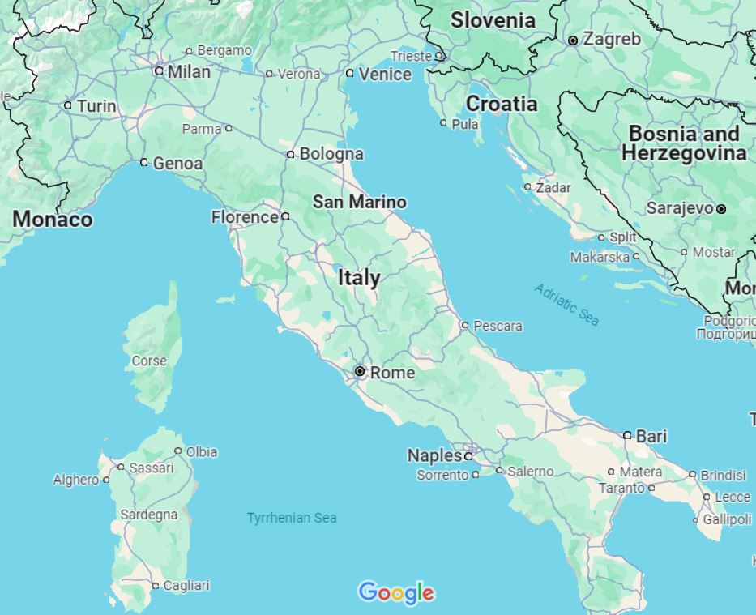


- The Little Italy neighborhood is, of course, [Italy](https://en.wikipedia.org/wiki/Italy) themed. [Ezio Auditore da Firenze](https://en.wikipedia.org/wiki/Ezio_Auditore_da_Firenze) is the protagonist in 3 [*Assassin’s Creed*](https://en.wikipedia.org/wiki/Assassin%27s_Creed) games and is from Florence. [Florence](https://en.wikipedia.org/wiki/Florence) and [Venice](https://en.wikipedia.org/wiki/Venice) are cities in Italy and the Italian names for them are Firenze and Venezia, respectively.


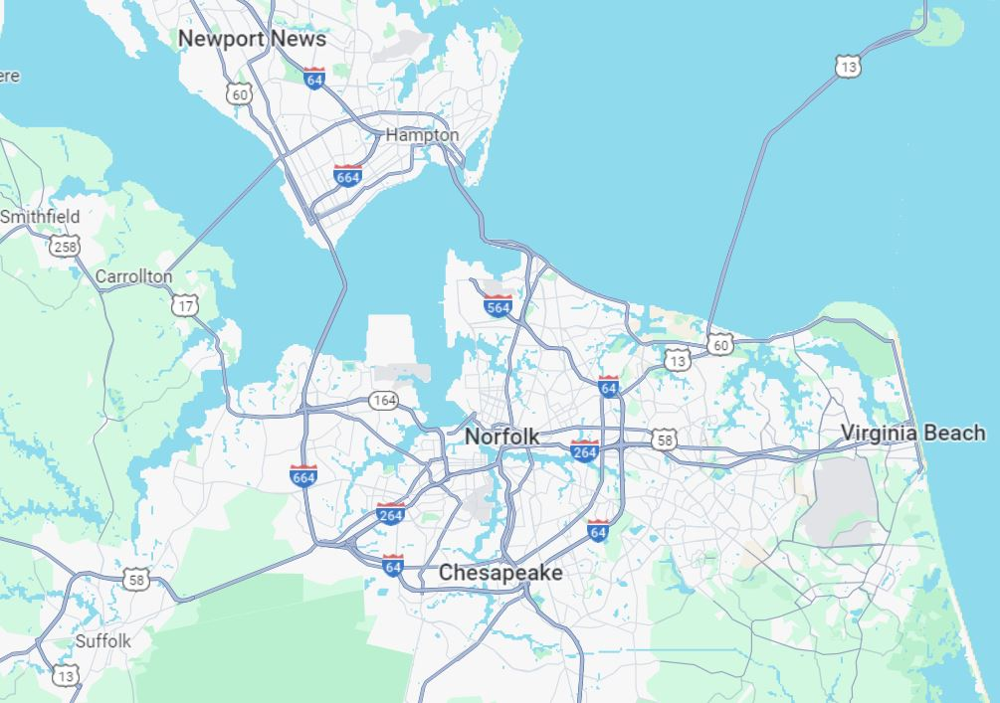

- [Carl Friedrich Gauss](https://en.wikipedia.org/wiki/Carl_Friedrich_Gauss), [Leonhard Euler](https://en.wikipedia.org/wiki/Leonhard_Euler), [Srinivasa Ramanujan](https://en.wikipedia.org/wiki/Srinivasa_Ramanujan), and [Euclid](https://en.wikipedia.org/wiki/Euclid) were mathematicians. Euclid Avenue is also a street in St. Louis. :fleur_de_lis:

- [Alan Turing](https://en.wikipedia.org/wiki/Alan_Turing), [Edsger Dijkstra](https://en.wikipedia.org/wiki/Edsger_W._Dijkstra), [Donald Knuth](https://en.wikipedia.org/wiki/Donald_Knuth), and [Dennis Ritchie](https://en.wikipedia.org/wiki/Dennis_Ritchie) are or were computer scientists, with Knuth being the only one still alive at the time of this writing.

- [Hampton](https://en.wikipedia.org/wiki/Hampton,_Virginia), [Chesapeake](https://en.wikipedia.org/wiki/Chesapeake,_Virginia), [Suffolk](https://en.wikipedia.org/wiki/Suffolk,_Virginia), and [Norfolk](https://en.wikipedia.org/wiki/Norfolk,_Virginia) are cities in the [Hampton Roads region of eastern Virginia](https://en.wikipedia.org/wiki/Hampton_Roads).


</details>

Each neighborhood has a number associated with it and these are shown in the 2<sup>nd</sup> table below. The purchase price of each street in a neighborhood is the neighborhood number divided by 8. The starting fee of a street is the purchase price divided by 8. This is what the fee is if the owner owns 1 or 2 of the streets in the neighborhood of that street. If a player owns all 3 of the streets in a neighborhood, then the fees for those streets increase and restaurants can be bought for them to increase the fees more. Streets can have a max of 5 restaurants. The purchase price of a restaurant is half of the street purchase price. Players can sell restaurants back for half of their purchase price. For neighborhoods where a player owns all streets, the fee for a street is the street starting fee × (2<var>n</var> + 2), where <var>n</var> is the number of restaurants on that street. This gives us the following values:

| Number of Restaurants | Street Starting Fee Multiplier |
| :-------------------: | :----------------------------: |
|           0           |               2                |
|           1           |               4                |
|           2           |               6                |
|           3           |               8                |
|           4           |               10               |
|           5           |               12               |

All of this info, along with some info from the "Pawning" section (the next section), gives us the following values. The last 6 columns are for the fees for a street in a neighborhood where a player owns all streets. The column headings are for how many restaurants are on that street.

| Neighborhood | Number | Purchase Price | Pawn and Restaurant Purchase Price | Unpawn Price | Restaurant Selling Price | Starting Fee |   0   |   1   |   2   |   3   |   4   |   5   |
| ------------ | :----: | :------------: | :--------------------------------: | :----------: | :----------------------: | :----------: | :---: | :---: | :---: | :---: | :---: | :---: |
| Vauxhall | 1 | $128 | $64 | $71 | $32 | $16 | $32 | $64 | $96 | $128 | $160 | $192 |
| Monrovia | 2 | $256 | $128 | $141 | $64 | $32 | $64 | $128 | $192 | $256 | $320 | $384 |
| Ozark | 3 | $384 | $192 | $212 | $96 | $48 | $96 | $192 | $288 | $384 | $480 | $576 |
| Augusta | 4 | $512 | $256 | $282 | $128 | $64 | $128 | $256 | $384 | $512 | $640 | $768 |
| Little Italy | 5 | $640 | $320 | $353 | $160 | $80 | $160 | $320 | $480 | $640 | $800 | $960 |
| Gauss | 6 | $768 | $384 | $423 | $192 | $96 | $192 | $384 | $576 | $768 | $960 | $1,152 |
| Turing | 7 | $896 | $448 | $494 | $224 | $112 | $224 | $448 | $672 | $896 | $1,120 | $1,344 |
| Hampton | 8 | $1,024 | $512 | $564 | $256 | $128 | $256 | $512 | $768 | $1,024 | $1,280 | $1,536 |

The Markdown for the rows of the table above was generated programmatically by the code at the end of [`Neighborhood.kt`](https://github.com/ncschroeder/Singletonopoly/blob/master/src/main/board/properties/Neighborhood.kt).

##### Screenshot

Landing on an owned street

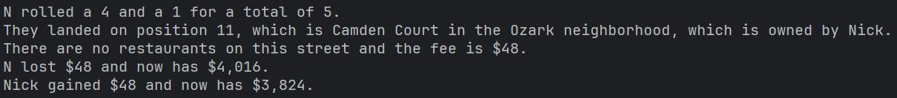


#### Pawning

Players can pawn a property to get some money but anybody who lands on a pawned property won't need to pay a fee. A pawned property must be unpawned in order to require players who land there to pay a fee. The money that a player gains from pawning a property is half of its purchase price. The money needed to unpawn is calculated by taking the pawn price, adding a 10.24% $(\frac{2^{10}}{100})$ fee, and rounding this to the nearest whole number. Streets must have no restaurants on them in order to be pawned, so if any restaurants get bought, then they must be sold.

##### Screenshot

Landing on a pawned property

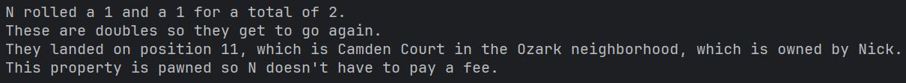

#### Seeing Property Info


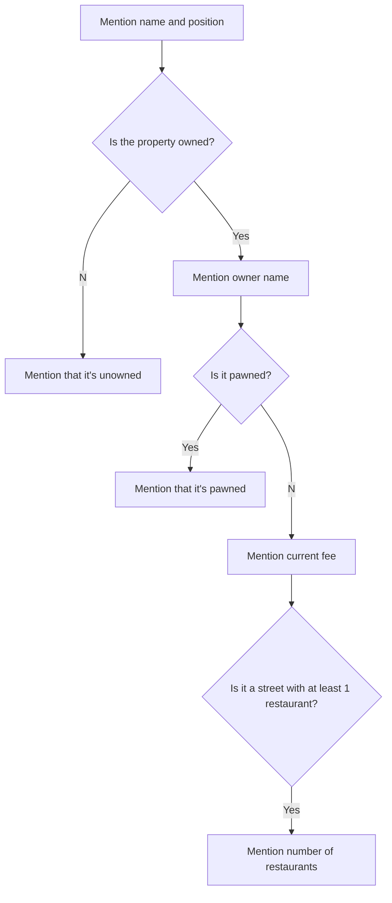

<details>
<summary>Screenshots</summary>
<br/>

Info for properties owned by a player

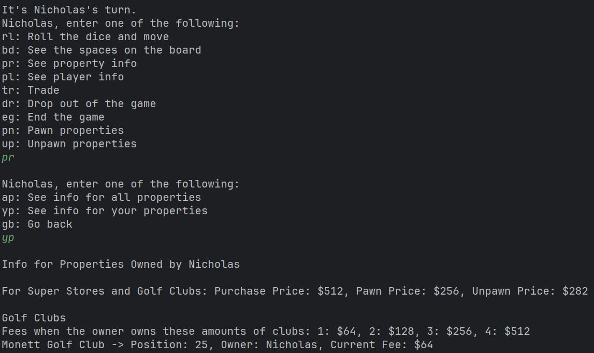
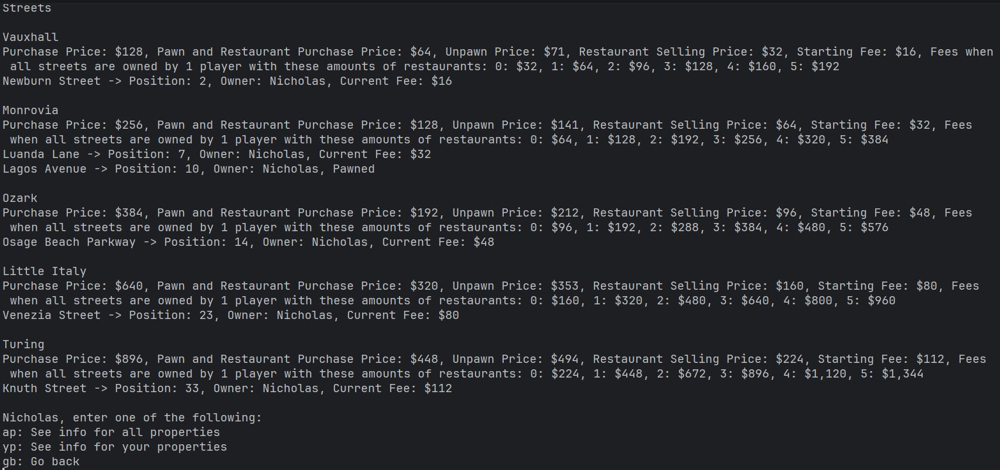

Info for all properties

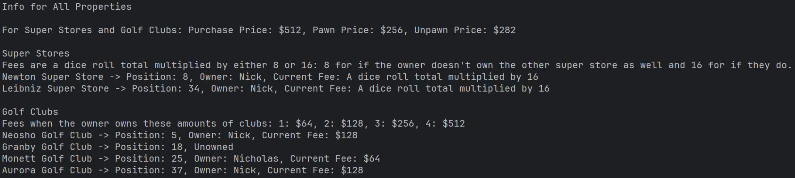
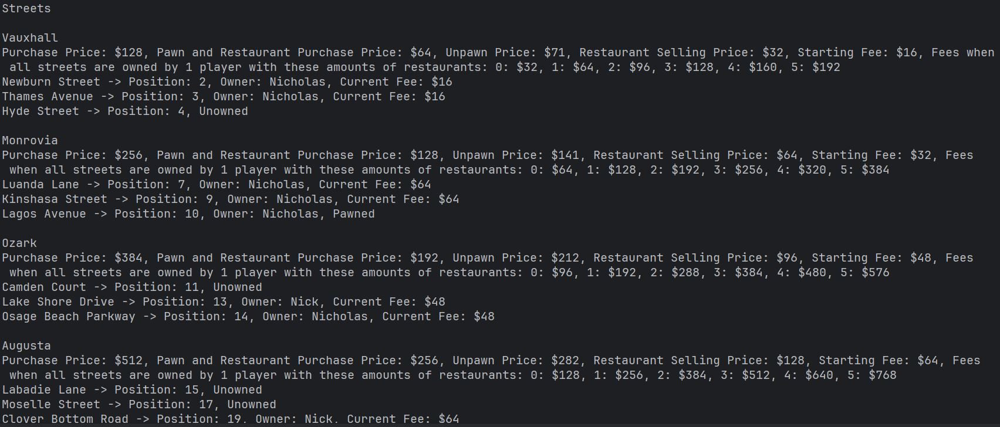
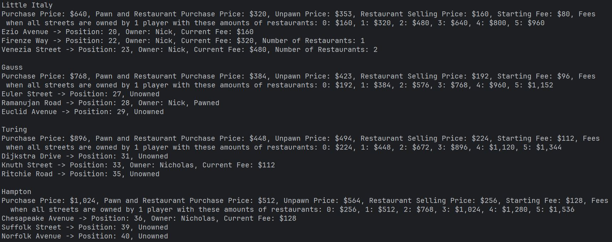

</details>

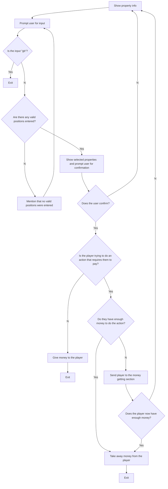

<details>
<summary>Screenshots</summary>
<br/>

Pawning

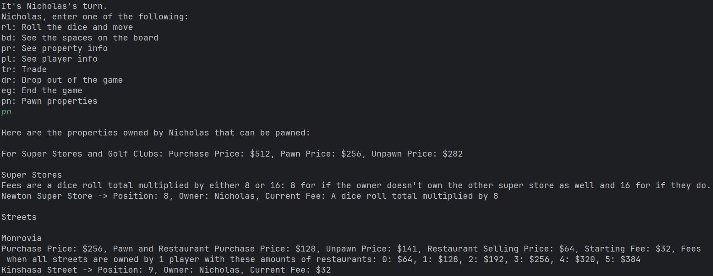
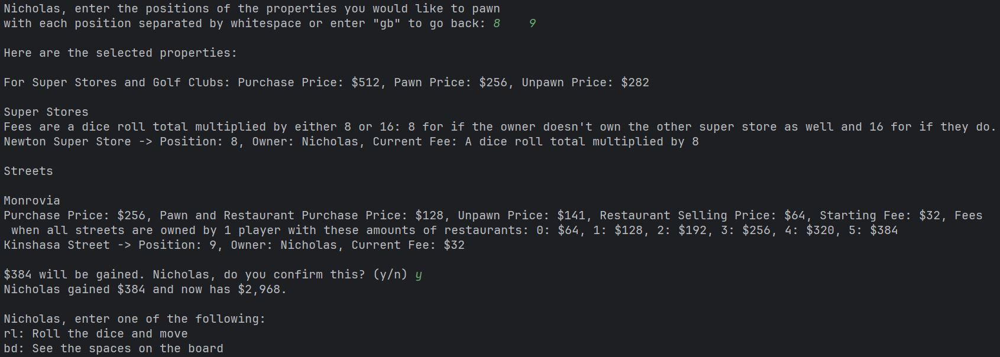

Buying a Restaurant

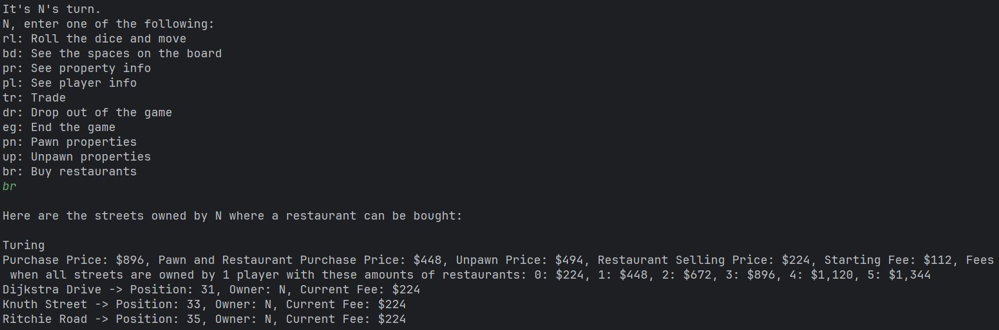


Invalid Input

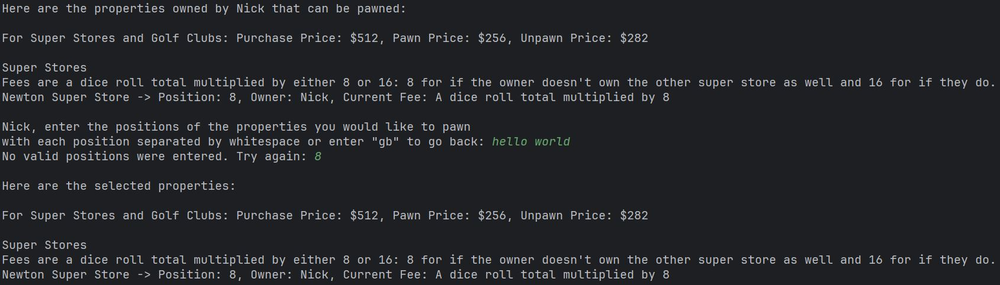

</details>


### Money Getting Section :heavy_dollar_sign:

When a player needs money, they'll be sent here. Sometimes a player is in a situation where they need money and chose to be in that situation. For example, they land on an unowned property and try to buy it without having enough money. Other times, a player needs money and didn’t choose to be in that situation. For example, they land on a property owned by someone else and don't have enough money to pay the fee.

When a player is at this section, they're given some options. If the player chose to be in their situation, then the 1<sup>st</sup> option is to go back but if they do this, then they won't do the thing they needed money for. Otherwise, the 1<sup>st</sup> option is to drop out of the game. The 2<sup>nd</sup> option is to try to make a trade with another player. Other options are pawning properties and selling restaurants on streets but each of these options are available only if the player has at least 1 property where that action can be done. If the player chooses an option other than the first one and gets enough money to do the thing they needed money for, then they'll exit the money getting section and do that thing. Otherwise, they'll stay in the money getting section and be prompted to do another option.

<details>
<summary>Screenshots</summary>
<br/>

Going back

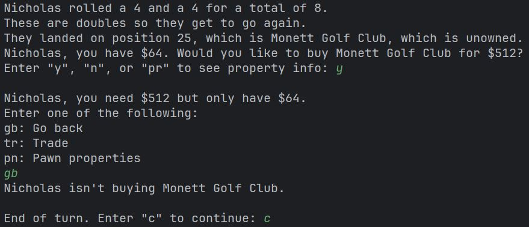

Pawning to get money

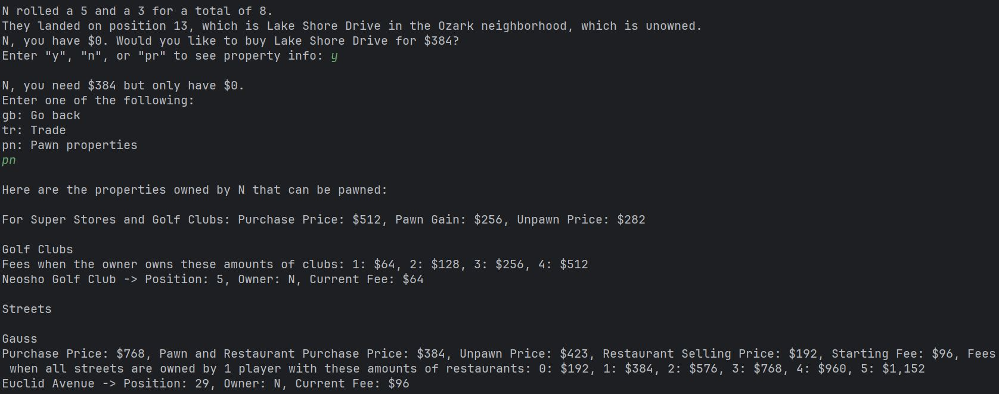
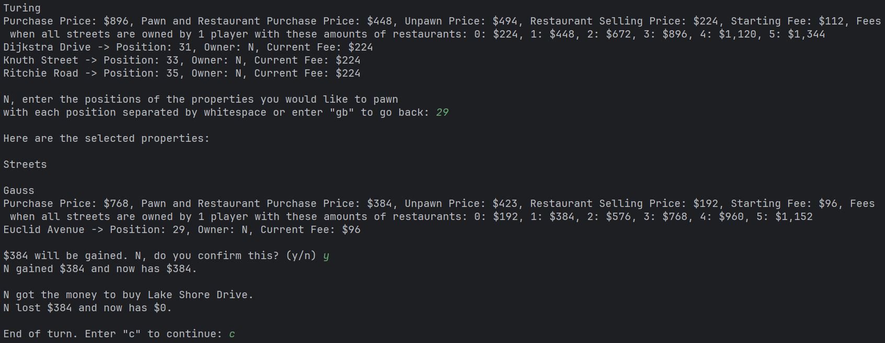

Player didn't choose

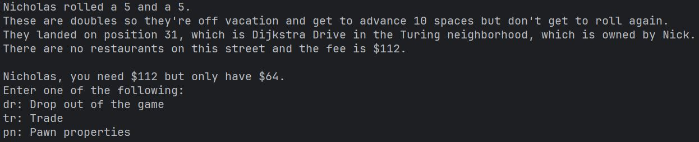

</details>


### Seeing Player Info

A player can choose to see player info at the beginning of their turn or during some parts of trading. The order of the players is the same as the order that was determined at the beginning. For each player, the 1<sup>st</sup> thing mentioned about them is their name. If they're out of the game, that'll be the only other thing mentioned about them. Otherwise, their position and money will be mentioned. If they have any get off vacation free cards, that'll be mentioned. If they're on vacation, that'll be mentioned along with how many turns they spent there.

#### Screenshot

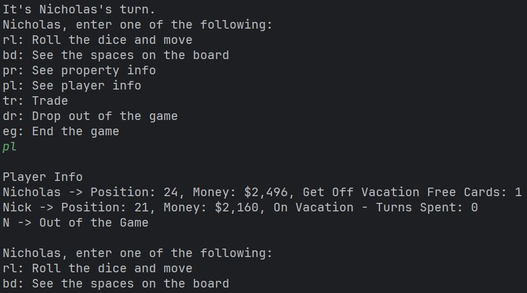


### Action Deck and Action Cards

The *Action Deck* is a deck of *Action Cards*, which are cards with action messages. When a player lands on a board space that says "Draw Action Card," they do that and do what the card says. The card will then be placed at the bottom of the deck, unless it's a get off vacation free card. In that case, the card gets removed from the deck and goes to the player that drew it. When a player uses that card, it goes at the bottom of the deck. The deck starts off with 21 cards and is shuffled every game.

Here are the messages of all cards in the deck:
- You gain :heavy_dollar_sign:128
- You gain :heavy_dollar_sign:256
- You lose :heavy_dollar_sign:128
- You lose :heavy_dollar_sign:256
- You get :heavy_dollar_sign:32 from every other player
- You get :heavy_dollar_sign:64 from every other player
- You must pay every other player :heavy_dollar_sign:32
- You must pay every other player :heavy_dollar_sign:64
- You must pay :heavy_dollar_sign:32 per restaurant that you own for maintenance
- You must pay :heavy_dollar_sign:64 per restaurant that you own for maintenance
- Move ahead 4 spaces
- Move ahead 8 spaces
- Move back 4 spaces
- Move back 8 spaces
- Lagos is the most populated city in Africa. Move to Lagos Avenue.
- Computer scientist Donald Knuth once said "Programs are meant to be read by humans and only incidentally for computers to execute." Move to Knuth Street.
- Go on vacation (appears twice)
- Get off vacation free. Keep this card and use it when needed, or trade it. (appears thrice, or 3 times)

#### Remarks

- If a player draws a "You lose :heavy_dollar_sign:x," "You must pay every other player :heavy_dollar_sign:x," or "You must pay :heavy_dollar_sign:x per restaurant that you own for maintenance" card and they don’t have enough money to pay, they'll be sent to the [money getting section](#money-getting-section-heavy_dollar_sign). If they decide to drop out, their properties will become unowned.

- If a player draws a "You get :heavy_dollar_sign:x from every other player" card and one of those other players doesn't have enough money to pay, they'll be sent to the money getting section. If they decide to drop out, their money and properties will go to the player that drew the card.

- If a player draws the Lagos Avenue card or Knuth Street card on a "Draw Action Card" space that's past that street on the board, that player will get to make a revolution. However, if a player draws a "Go on vacation" card, they'll be sent to the "Vacation" space without making a revolution, regardless of which "Draw Action Card" space they drew the card from.

- If a player lands on the "Draw Action Card" space at position 6 of the board and draws the "Move back 8 spaces" card, they'll get moved to position 38 and will luckily be able to make a revolution and collect :heavy_dollar_sign:512 once they move at least another 3 spaces forward.

<details>
<summary>Screenshots</summary>
<br/>

Drawing get money from other players card

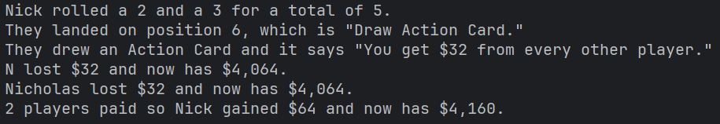

Drawing pay other players card

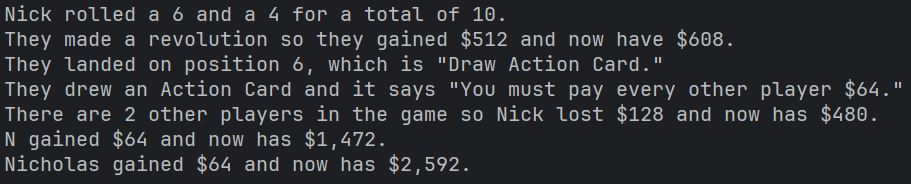

Drawing restaurant maintenance card

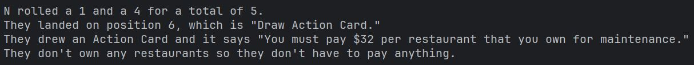

Drawing move ahead card

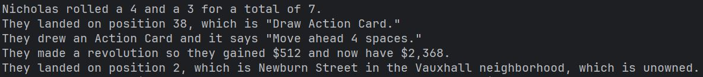

Drawing Knuth Street card

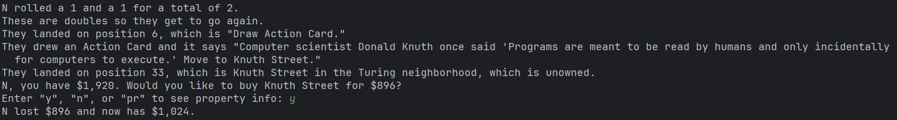

Drawing get off vacation free card

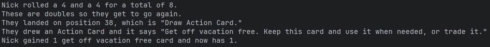

</details>


### Vacation :desert_island: :beach_umbrella:

When a player lands on the "Go on Vacation" space on the board, draws an Action Card with this same message, or rolls doubles thrice, or 3 times, in a row, that player will be sent to vacation and their position will be changed to the "Vacation" space on the board. The player is stuck on this space for as long as they're on vacation. On the player's next turn, they'll have the choice of either trying to roll doubles, paying :heavy_dollar_sign:128 (2<sup>7</sup>) to get off vacation, or using a get off vacation free card if they drew one from the Action Deck or got one from a trade. If they try to roll doubles and succeed, then the player is off vacation and get to advance the amount they rolled. Even though they rolled doubles, they won't get to go again. A player can be on vacation for a max of 3 turns by trying to roll doubles and failing for 2 turns. If they fail to roll doubles on their 3<sup>rd</sup> turn, then they get off vacation.

<details>
<summary>Screenshots</summary>
<br/>

Rolling on vacation

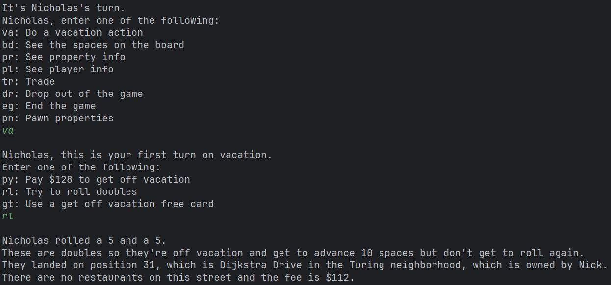

Paying on vacation

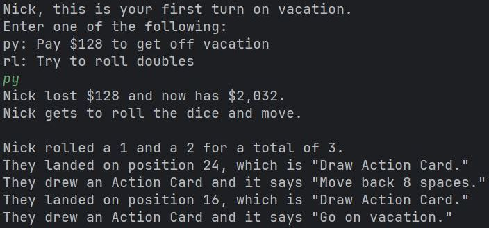

</details>


### Trading

- The 2 players can’t trade anything besides money.
- The initiating player went to the trading section from the money getting section and selected to trade with a player that doesn’t have money.


#### Screenshots

Trying to trading at the start of a game

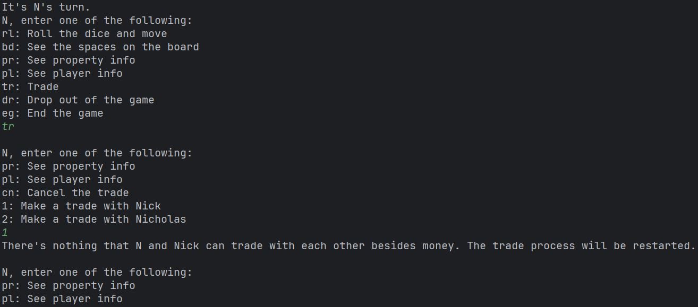

The IP not selecting anything that they would like


A successful trade


